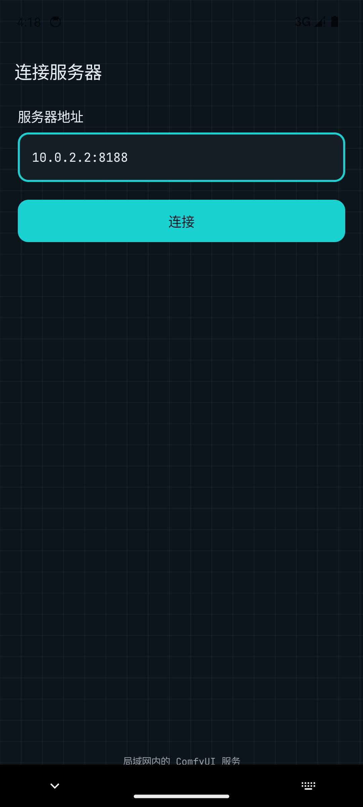
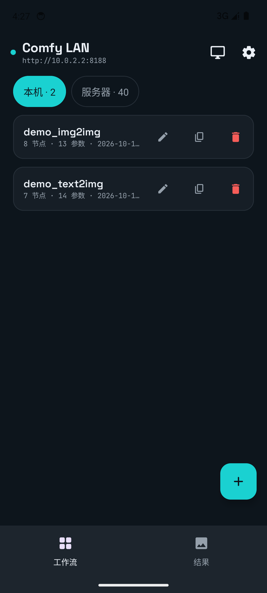
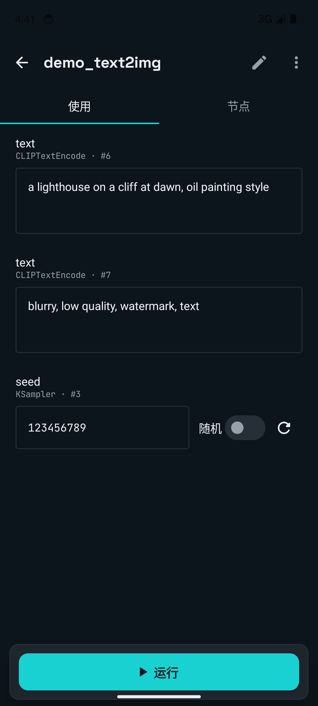
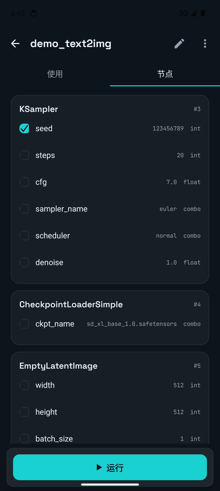
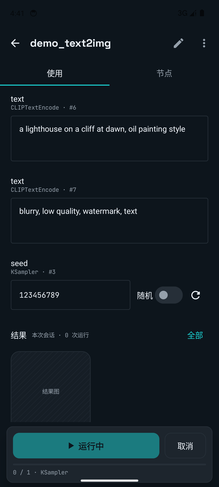
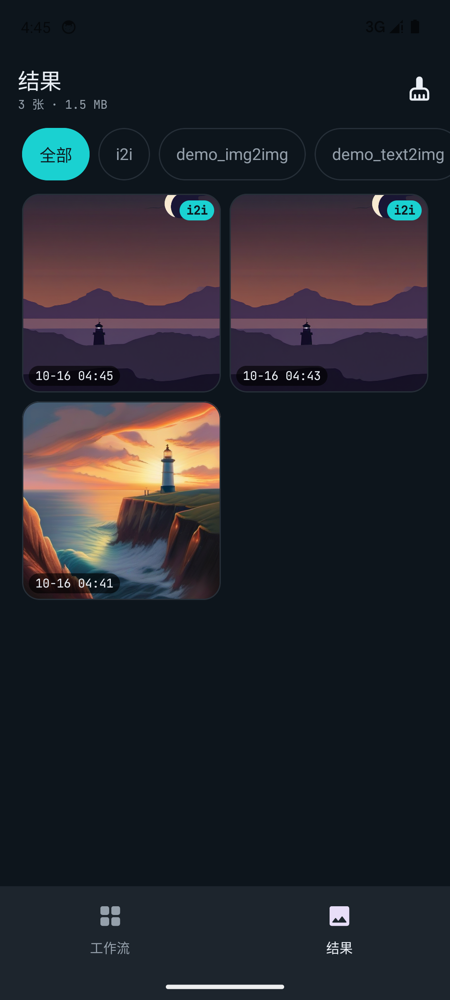
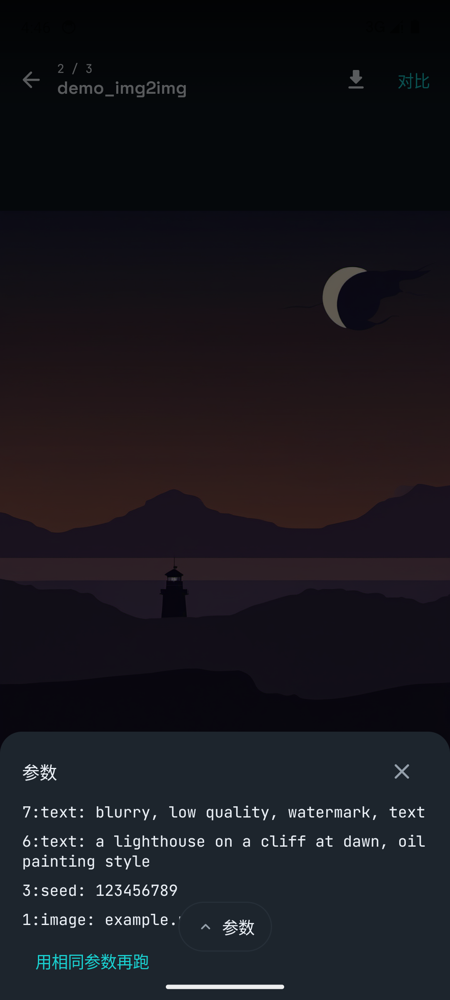
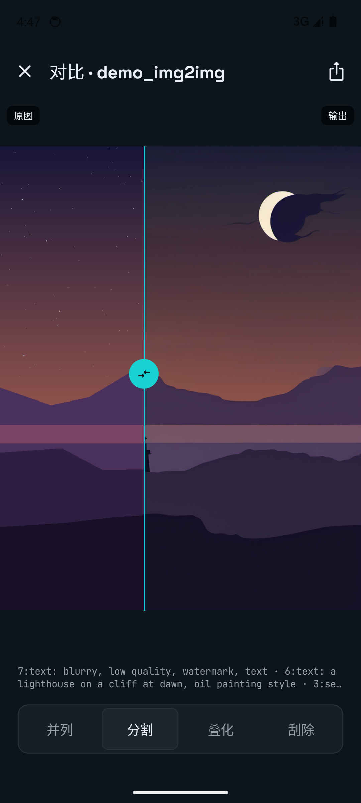

# Comfy LAN

**English:** A native Android client for ComfyUI on your LAN. *Edit on desktop, use on mobile*: workflows stay as-is on the server, while the app turns the parameters you choose to expose into a native form — pick an image, tweak the prompt, run, watch progress over WebSocket, and browse results with i2i compare. A WebView embeds the official ComfyUI frontend when you do need the full canvas. 中文介绍见下。

局域网 ComfyUI 的 Android 原生客户端。编辑归编辑，使用归使用：

- **使用模式**：工作流里选定要暴露的参数（输入图、prompt、seed、模型……），以原生表单操作；提交运行、WebSocket 进度、结果图缓存。
- **节点模式**：浏览全部节点，勾选哪些 widget 对外暴露（暴露配置存本机 Room，按工作流内容哈希关联，不改工作流文件）。
- **工作流衍生**：库内复制（含暴露配置）、另存为新工作流（带当前表单参数）、保存当前参数为下次打开的默认值。
- **运行恢复**：每次提交落盘 `pending_runs`；进程被杀/切后台后重开详情页，轮询服务器 `/history` 收尾入库，进度不丢。
- **结果中心**：结果本地缓存（LRU 500 MB），查看器带参数抽屉与「用相同参数再跑」，i2i 结果支持并列/分割/叠化/刮除四种对比。
- **编辑模式**：WebView 内嵌官方 ComfyUI 前端（新版前端 ≥1.5x 移除了 `window.app` 桥，注入/保存回 App 在其上自动降级为普通画布）。

客户端只把标准 API-format prompt 发给服务器（`POST /prompt`）；暴露什么、怎么展示是客户端规则，由 `PromptConverter` 负责翻译。

## 截图 / Screenshots

| 连接 | 工作流库 | 表单 | 节点勾选 |
|---|---|---|---|
|  |  |  |  |

| 运行进度 | 结果中心 | 查看器 | i2i 对比 |
|---|---|---|---|
|  |  |  |  |

演示用工作流在 [`demo/`](demo/)（标准 txt2img / img2img，官方内置节点，含示例输入图）。

## 快速开始

1. 电脑上跑起 ComfyUI（默认端口 8188）
2. 安装 APK、连接：模拟器填 `10.0.2.2:8188`（指向宿主机），真机填电脑局域网 IP，如 `192.168.x.x:8188`
3. 「服务器」分区导入工作流（或本地导入 JSON），首次打开自动预选输入图/prompt/seed 等参数
4. 勾选想要暴露的参数 → 表单运行

## 构建

需要 JDK 17 + Android SDK（platform 35）。`local.properties` 指向本机 SDK。

```
gradlew :app:assembleDebug        # 构建
gradlew :app:installDebug         # 安装到连接的设备/模拟器
gradlew :app:testDebugUnitTest    # 离线单元测试
```

测试夹具说明：仓库自带脱敏的 `demo_i2i.json` / `object_info_demo.json`；本地开发者可放入自己的 `local_i2i.json` / `local_object_info.json`（已 gitignore），`ConverterLiveTest` 会在缺失时自动跳过。

## 结构

```
model/    UI 格式工作流 + /object_info 的容错 DTO、WidgetDef
api/      ComfyApi(REST/上传/历史/userdata/下载) 与 ComfyEvents(WebSocket 进度) 的 OkHttp 实现
convert/  UI 格式 → API prompt 转换器（bypass 重路由、subgraph 展开、widget 值解析）
data/     Room(工作流库 + 暴露配置 + 结果缓存 + pending_runs) 与 DataStore(服务器地址)
ui/       Compose 界面：连接、工作流库(本机/服务器分区)、使用表单、节点勾选、
          结果中心、大图查看器、i2i 对比(并列/分割/叠化/刮除)、WebView 编辑
ui/theme/ 节点图纸主题：OKLch→sRGB 色 token、Space Grotesk/JetBrains Mono 字阶
demo/     演示工作流（官方内置节点，任何标准 ComfyUI 可运行）
```

## 已知取舍

- 新版 ComfyUI 前端（≥1.5x）不再向 `window` 暴露 app 实例（上游 [ComfyUI_frontend#7757](https://github.com/Comfy-Org/ComfyUI_frontend/issues/7757)），编辑模式的画布注入与「保存回App」在其上自动降级；旧版前端全功能可用。
- 表单值显式「保存为默认」才持久化；未保存的临时修改随进程消失。
- 输入图选择走 SAF `OpenDocument`（相册 Photo Picker 不索引 webp，SAF 全类型可见）。
- 编辑模式：WebView 必须显式 `MATCH_PARENT` 并延迟到布局后加载，否则 Chromium 把初始包含块钉成 0 高、前端所有 `100vh` 塌陷成黑屏。
- 自定义 socketless widget 类型（如 IMAGECOMPARE）的默认值是逐个硬编码的，见 `ObjectInfo.kt` 的 ponytail 注释。

## License

[MIT](LICENSE)
